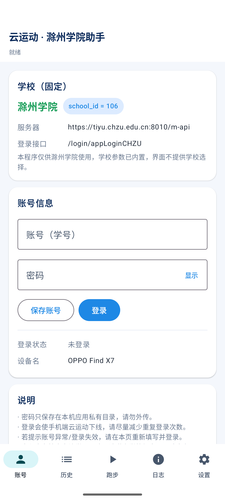
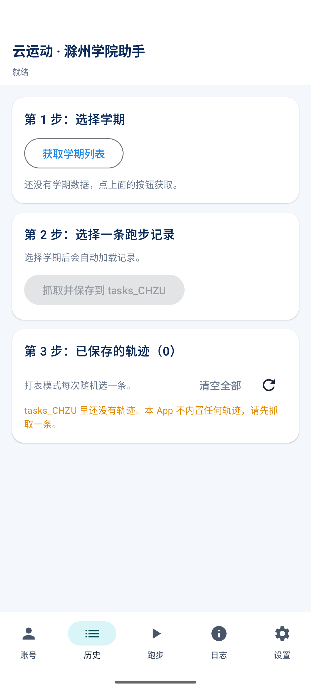

# 云运动 · 滁州学院助手（Android）

> CHZUyyd 安卓版 v1.0.0 · 仅供 **滁州学院**（school_id=106）使用
> 采用《CHZUyyd 安卓版执行方案》中的 **B1 路线**：原生 Compose 界面 + Chaquopy
> 内嵌 Python 3.14 协议层；不是把桌面 tkinter 程序直接打包成 APK。

**许可：GPL-3.0-or-later** — 本项目以 GNU 通用公共许可证第 3 版（或其后续版本）
发布，许可证全文见 [LICENSE](LICENSE)。

理论来说可以根据这个项目完成其他任何使用云运动的学校的刷跑助手，有能力的朋友可以自行研究




## 一、成果

| 内容 | 路径 |
|---|---|
| 可安装 APK（arm64，已签名） | [GitHub Releases v1.0.0](https://github.com/sanctuary-x/CHZUyyd/releases/latest) |
| APK SHA-256 | `release/SHA256.txt` |
| 完整 Android 工程 | `android/` |
| 纯 Python 协议层 | `python/proto/` |
| 使用说明 | `docs/用户使用说明.md` |
| 构建说明 | `docs/构建说明.md` |
| 测试报告 | `docs/真机测试报告.md` |
| 生成约定 | `docs/云运动助手-生成约定.md` |
| 许可证 | `LICENSE`（GPL-3.0-or-later） |

> **安装包放在 GitHub Releases**（源码仓库不保存 28MB 的 APK 二进制）。
> **仓库不包含签名私钥**：`android/keystore/` 与 `android/keystore.properties`
> 已被 `.gitignore` 排除。Releases 中的 APK 已用本机私钥签名，可直接安装；
> 如需重新构建 release，请按 `docs/构建说明.md` 自行生成签名。

## 二、功能（与桌面版对齐）

| 页面 | 功能 |
|---|---|
| **账号** | 学号/密码登录；学校固定滁州学院；登录状态、token、设备信息 |
| **历史数据** | 获取学期 → 查询记录 → 抓取轨迹保存到 `tasks_CHZU`；**单条删除 / 清空全部** |
| **跑步** | 无轨迹时提示先抓取；有轨迹后可立即跑或定时跑 |
| **定时跑步** | 目标次数、多个 `HH:MM` 时间点、补跑窗口 2/5/15/30/60 分钟、漂移开关 |
| **立即跑步** | 打表模式，前台服务执行，通知栏 + 页面进度条 + 剩余时间 |
| **自动执行** | `AlarmManager.setExactAndAllowWhileIdle` 到点触发，前台服务上传，失败/完成通知 |
| **日志** | 全量运行日志（页面 + `files/logs/app.log`） |
| **设置** | 通知权限、精确闹钟、电池优化、重排闹钟、检查补跑、数据目录、免责声明 |

**不内置任何历史轨迹**：首次安装 `tasks_CHZU` 为空，必须先到「历史」页抓取
至少 1 条滁州学院记录，才能使用打表模式。支持单条删除 / 清空全部轨迹。
生成约定见 [docs/云运动助手-生成约定.md](docs/云运动助手-生成约定.md)。



## 三、安卓架构

```
Compose UI（5 个页面）
        │  StateFlow
AppRepo（状态 / 业务动作 / 日志）
        │
RunService（前台服务，dataSync）──→ Chaquopy ──→ python/proto
AlarmScheduler（精确闹钟）──→ AlarmReceiver ──┘
BootReceiver（开机 / 改时间恢复闹钟）
        │
SharedPreferences + filesDir/tasks_CHZU + files/logs
```

协议层 `python/proto/`：

| 模块 | 职责 |
|---|---|
| `config.py` | 滁州学院常量、密钥、设备信息 |
| `crypto.py` | SM2 / SM4 / MD5（随包自带纯 Python gmssl 子集） |
| `http.py` | urllib 会话、gzip、关闭证书校验（与桌面版一致） |
| `login.py` | 登录、token 获取 |
| `history.py` | 学期 / 记录 / 轨迹落盘；拒绝非 106 记录 |
| `run.py` | 打表开始 → 分片上传 → 结束；漂移；进度回调；校时校验 |
| `api.py` | Chaquopy 入口，所有函数返回 JSON 字符串 |

**零 pip 依赖**：`gmssl` 只复制了 `sm2/sm3/sm4/func` 四个纯 Python 文件，
并去掉了只在签名时才需要的 `pycryptodomex` 导入；HTTP 用标准库 `urllib`。
因此 APK 里没有 `requests`、`pycurl`、`pycryptodome` 等第三方包。

## 四、仅供滁州学院使用

1. `proto/config.py` 固定 `SCHOOL_ID=106`、`SCHOOL_HOST=https://tiyu.chzu.edu.cn:8010/m-api`、
   `SCHOOL_LOGIN_URL=appLoginCHZU`；
2. 登录请求固定 `schoolId=106`，不提供学校选择；
3. 开始跑步时校验服务器返回的 `schoolId`；
4. 抓取历史时校验记录 `schoolId`，非 106 拒绝保存；
5. `RunSession.start()` 遇到服务器 `canSport=N` 时直接把学校提示原样显示
   （例如“当前时间不在学校规定的跑步时间内”），不会误报成网络错误。

## 五、构建

### 环境

- Windows 10/11
- JDK 17/21（本机 `C:\Program Files\Java\jdk-21.0.11`）
- Android SDK：platform 35、build-tools 35.0.0（本机 `C:\Android\sdk`）
- Python 3.14（Chaquopy `buildPython` 需要与 App 的 Python 大版本一致；
  默认使用 `py -3.14`，也可用 `CHZU_BUILD_PYTHON` 指定 `python.exe`）
- Gradle 8.9（工程自带 wrapper，首次构建会下载）

### 一键构建

```bat
build_apk.bat
```

产物：

```
dist/CHZUyyd-v1.0.0-arm64.apk    ← 已签名，arm64-v8a
dist/CHZUyyd-v1.0.0-debug.apk    ← 调试用，arm64-v8a + x86_64
```

### 手动构建

```powershell
cd android
.\gradlew.bat assembleDebug
.\gradlew.bat assembleRelease "-PchzuAbis=arm64-v8a"
```

> 工程使用 `android.overridePathCheck=true`，因此可以直接放在中文路径下构建。
> 仓库不包含 `android/keystore.properties` 与 `android/keystore/*.jks`；
> 重新构建 release 前请按 `docs/构建说明.md` 生成自己的签名。
> Releases 中的 APK 已签名，可直接安装。

## 六、测试结果（本机实测）

- Python 协议离线测试：**12 / 12 通过**
- Kotlin 调度逻辑单元测试：**7 / 7 通过**
- Android 15（API 35）模拟器 x86_64：
  - 安装、启动、Python 3.14 初始化成功；
  - 不内置轨迹，首次启动 `tasks_CHZU` 为空；
  - **真实滁州学院账号登录成功**；token 持久化；
  - 获取学期 9 个、本学期跑步记录 8 条；
  - 抓取并保存 `tasklist_0.json`（2.22 km）；
  - **单条删除 / 清空全部** 验证通过；
  - release（arm64+x86_64 通用包）安装、启动、签名校验通过；
    最终交付的 arm64 包已通过签名与 ABI 校验。
- 定时/前台服务代码与 BBUyyd 版完全一致（Kotlin 调度单测 7 项通过）；
  CHZU 版本次未重复做锁屏闹钟实测。
- 未完成：**成功完成一次真实跑步**（本次未在学校允许时段内测试），
  以及多品牌真机的 OEM 后台存活测试。详见 `docs/真机测试报告.md`。

## 七、后台定时说明

- 使用 `AlarmManager.setExactAndAllowWhileIdle`，到点启动前台服务；
- 前台服务类型 `dataSync`，带常驻通知，上传期间持有 `PARTIAL_WAKE_LOCK`；
- 开机、改时间、改时区后由 `BootReceiver` 重排闹钟；
- 每次成功后重排下一次；目标次数达成自动关闭；
- 错过时间点按“补跑窗口”补跑；
- Android 12+ 需要“精确闹钟”权限，Android 13+ 需要通知权限；
- 国产 ROM 还需手动允许“自启动 / 后台活动 / 忽略电池优化”，
  否则锁屏后仍可能被系统杀掉。App「设置」页提供了跳转入口。

## 八、目录结构

```
CHZUyyd-Android/
├── python/proto/                 # 纯 Python 协议层（PC/Android 共用）
│   └── vendor/gmssl/             # 随包 gmssl 子集
├── android/
│   ├── app/src/main/
│   │   ├── java/com/chzu/yyd/     # Compose 界面 + 服务 + 调度
│   │   ├── assets/tasks_CHZU/     # 说明.txt（不内置轨迹）
│   │   └── AndroidManifest.xml
│   ├── keystore/                 # 本机签名（已 gitignore，不入库）
│   └── gradlew.bat
├── tests/
│   ├── test_proto_offline.py     # 12 项协议离线测试
│   └── live_proto_check.py       # 真机/PC 联调脚本（需 CHZU_USER/CHZU_PASS）
├── docs/
├── release/                      # APK 校验值 + 发布说明（APK 在 GitHub Releases）
├── dist/                         # 本地构建输出（gitignore）
└── build_apk.bat
```

## 九、限制与风险

1. **未完成真实跑步**：本次未在学校允许时段内测试，未产生跑步记录。
   协议层的开始/上传/结束参数已用合成轨迹做离线校验；请在允许时段
   （以学校服务器提示为准）点「立即执行一次」实测。
2. **OEM 后台**：定时/前台服务代码与 BBUyyd 版一致，BBUyyd 版模拟器
   已验证锁屏到点触发；CHZU 版本次未重复实测，真机仍需按引导授权，
   并做 3 天锁屏测试。
3. **账号安全**：密码/token 保存在应用私有 SharedPreferences（未使用
   Keystore 加密，MVP 取舍）；手机未 root 时其他应用无法读取。
4. **合规**：打表属于模拟数据，被人工核查有风险；请遵守学校规定，风险自负。
5. 本程序不提供学校选择，也不接受其他学校账号或轨迹。

## 十、第三方组件

AndroidX / Compose / Chaquopy / gmssl 等第三方组件说明见
[THIRD_PARTY_NOTICES.md](THIRD_PARTY_NOTICES.md)。

## 十一、许可

本项目采用 **GNU 通用公共许可证第 3 版（或其后续版本）**，即
**GPL-3.0-or-later**（SPDX 标识：`GPL-3.0-or-later`）。
许可证全文见仓库根目录 [LICENSE](LICENSE)。

```
CHZUyyd Android —— 滁州学院云运动助手（安卓版）
Copyright (C) 2026 sanctuary-x

本程序是自由软件：你可以依据自由软件基金会（FSF）发布的
GNU 通用公共许可证第 3 版（或你选择的任何更新版本）的条款，
再分发和/或修改它。

本程序分发时希望它有用，但不提供任何担保，甚至不提供适销性
或特定用途适用性的默示担保。详见 GNU 通用公共许可证。

你应当已随本程序收到一份 GNU 通用公共许可证副本；
如果没有，见 <https://www.gnu.org/licenses/>。
```

### 分发与修改

- **分发 APK 需同时提供源代码**：从本仓库构建并对外分发 APK 时，须一并提供
  对应的完整源代码（即本仓库，满足 GPL-3.0 第 6 条对 Corresponding Source
  的要求）；
- **修改版仍是 GPL**：修改后再分发，必须继续以 GPL-3.0 发布、保留许可声明，
  并按第 5 条注明“已修改”及日期；
- **不得附加额外限制**：不得对接收者施加 GPL-3.0 之外的许可费、专利限制等
  额外约束（第 10、11 条）；
- 商用分发、二次开发均被允许，但须同样开源。

### 第三方组件

gmssl（MIT）、Chaquopy（MIT）、AndroidX / Compose / Material 3 / Kotlin /
Gradle（Apache-2.0）均与 GPL-3.0 兼容，逐项说明见
[THIRD_PARTY_NOTICES.md](THIRD_PARTY_NOTICES.md)。

### 来源说明

原始桌面版协议逻辑来自 CHZUyyd / yunForNewVersion 项目；Android 端的界面、
服务、闹钟调度与协议封装为本项目新写。本程序仅供技术交流学习，请遵守
学校规定，风险自负；许可证不代表对使用场景的认可或授权。

